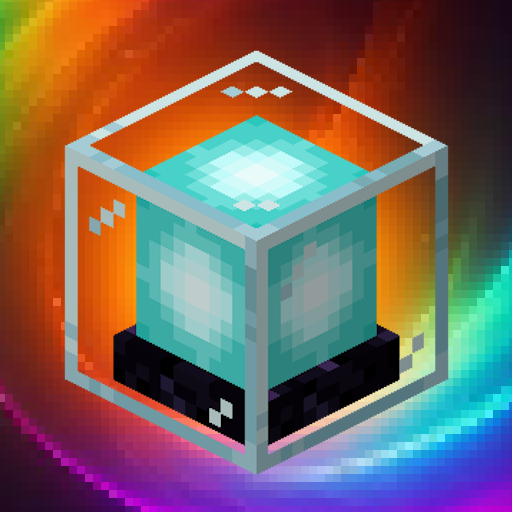

# Beacon Aura

## Improves beacons by allowing you to soak in a beacon's effects with duration stacking over time

 

Beacons are some of the hardest items to obtain, but they feel underwhelming and are only circumstantially useful. **Beacon Aura** solves this by allowing you to *soak* in the beacon's effects while within its range, stacking duration over time, so you can enjoy their effects long after you leave their radius. The speed and cap of the effects buildup is determined by the beacon's level.

### Features

* **Extended Effect Duration:** Accumulate beacon effects while in range, to be enjoyed while out of range.
* **Customizable Limits:** Configure maximum effect durations per beacon level, as well as effect buildup speed.
* **No Beacon Particles:** Completely disables beacon particles.
* **Serverside:** When installed on a server, players do not need to install the mod. Can also be installed in singleplayer worlds.

### Configuration

You can configure the following values with [ModMenu](https://github.com/TerraformersMC/ModMenu) and [YetAnotherConfigLib](https://github.com/isXander/YetAnotherConfigLib), or by editing `config\beacon-aura.json`.

* **Seconds Per Level:** The number of seconds added to the beacon effect's duration per beacon level, per 4 seconds. (Default: 4)
* **Maximum Minutes Per Level:** The maximum duration, in minutes, that the beacon effect can last for each level. (Default: 15)
